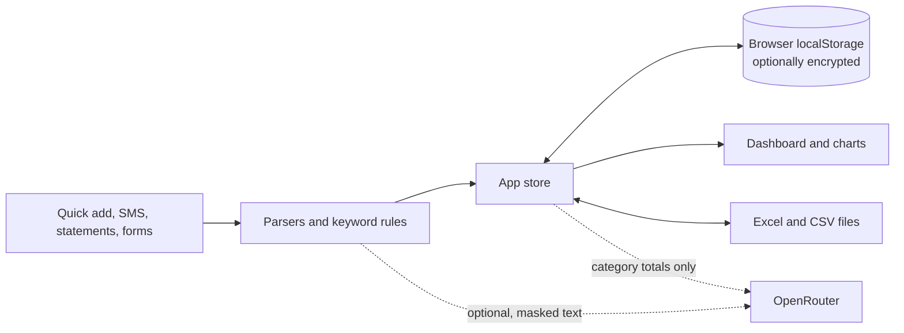

# ₹ Fin Track

A private, offline-capable personal finance tracker built for India. Record spending in plain words,
import bank statements, watch your budgets and see how much you can safely spend each day.

**Live app:** https://fin-track-six-flame.vercel.app

Your records stay in your own browser. There is no account, no server and no database.

---

## Contents

- [What it does](#what-it-does)
- [Getting started](#getting-started)
- [Using the app](#using-the-app)
- [How the numbers are calculated](#how-the-numbers-are-calculated)
- [How it works](#how-it-works)
- [Tech stack](#tech-stack)
- [Data model](#data-model)
- [Privacy and security](#privacy-and-security)
- [Development](#development)
- [Deployment](#deployment)
- [Known limitations](#known-limitations)

## What it does

| Area | Features |
|---|---|
| **Recording** | Natural-language quick add, manual entry, SMS "smart paste", bank statement import |
| **Ledger** | Search, filter by type, category, spending nature and account, edit in place, delete |
| **Dashboard** | Safe-to-Spend, 50/30/20 split, cash flow, category vs budget, daily and six-month trends |
| **Planning** | Monthly budgets, recurring bills, savings goals (sinking funds) |
| **Reimbursements** | "Owed to Me" tracker for money others need to pay back |
| **Automation** | Keyword rules that categorise merchants for you |
| **Data** | Excel and CSV export, full backup and restore |
| **Help and display** | First-visit tour, Tutorial tab, light, dark and system themes |
| **Optional AI** | Parsing, categorising and monthly savings tips using free models through your own OpenRouter key |
| **Protection** | Optional passphrase encryption |

Everything except the AI features works without an internet connection once the app has loaded.
Amounts are shown in rupees with Indian digit grouping, for example `₹1,25,000.00`.

## Getting started

### Just use it

1. Open the [live app](https://fin-track-six-flame.vercel.app). It starts with sample data.
2. Explore, then press **Clear sample data**.
3. Add your first transaction in the quick-add bar.
4. Go to **Import & Export → Full backup** from time to time.

### Run it on your computer

You need [Node.js](https://nodejs.org) 24 (the version used in CI) and npm.

```bash
git clone https://github.com/Benjamin-G-Leo/Fin_Track.git
```

```bash
cd Fin_Track
```

```bash
npm install
```

```bash
npm run dev
```

Then open the address printed in the terminal, usually http://localhost:5173.

## Using the app

Choose **Light**, **Dark** or **System** (follow your device) from the theme menu at the top.

A short tour opens on your first visit. The **Tutorial** tab replays it, lists its steps and explains each feature.

### Quick add

Type one line and press **Add**. A preview shows how it will be saved.

| You type | The app understands |
|---|---|
| `450 lunch swiggy UPI` | ₹450 expense, Food & Dining, HDFC UPI |
| `2500 electricity bill` | ₹2,500 expense, Utilities & Bills |
| `salary 1.25L sbi 1/11` | ₹1,25,000 income, SBI Savings, 1 November |
| `300 uber yesterday` | ₹300 transport expense dated yesterday |
| `1200 team lunch cash #r` | ₹1,200 reimbursable expense |
| `1000 atm withdrawal` | A transfer, not spending |

Dates are read day first. `k`, `L`/`lakh` and `cr` suffixes work.

### Smart paste (Transactions tab)

Paste one or more bank or UPI alerts. The app reads amount, payee, date and account offline, shows a
preview, and imports only the rows you keep.

### Bank statements (Import & Export tab)

1. Choose an `.xlsx`, `.xls` or `.csv` file.
2. Check the column mapping (Date, Narration, Debit, Credit, Account). Presets exist for HDFC, ICICI
   and SBI, and you can save your own.
3. Review the preview. Likely duplicates are flagged and left unticked.
4. Import.

### Export and backup (Import & Export tab)

| Button | Contents |
|---|---|
| **Export .xlsx** | Transactions, Monthly Summary, Recurring Bills, Savings Goals |
| **Full backup** | The above plus Budgets and Keyword Rules |
| **Transactions .csv** | Transactions only |

Use **Restore from a Fin Track file** to bring a backup back, either merging or replacing.
A backup does not include your API key, app settings or saved import presets.

### Optional AI features

Open **AI settings** and add an [OpenRouter](https://openrouter.ai) key. This unlocks:

- **AI parse** for a quick-add line
- **AI Categorize Unmatched** in smart paste and statement import
- **Generate AI Insights** on the dashboard

#### Free models only

Fin Track never uses paid models.

- The default is `openrouter/free`, which picks from the free models currently available.
- You can choose another model only if its ID ends in `:free`.
- Every request sets a maximum price of zero, so OpenRouter should refuse it rather than bill you.

Free models have trade-offs: answers can be less accurate and vary between requests, you may hit rate
limits, and some are unavailable while **Only use providers that do not store prompts** is ticked.
Always check results before saving. A low spending limit on your key is still sensible.

## How the numbers are calculated

**Safe to spend per day** (current month only)

```text
(income this month − bills due by month end − savings target − personal expenses)
÷ days left in the month, including today
```

- The savings target is 20% of income unless you set one.
- Investments made or still due count towards the target, and raise it if they exceed it.
- Overdue bills count once for each missed period.

**50/30/20** compares Needs (limit 50% of income), Wants (limit 30%) and Savings (aim for 20% or more).

**Owed to Me** is reimbursable expenses minus reimbursable income, per merchant. Reimbursable amounts
never count as your own spending or income.

**Transfers** (including ATM withdrawals and credit card bill payments) are left out of totals, so
money is not counted twice.

**Duplicates** are detected from date, amount and merchant name. A confirmed repeat is kept with a
`-2`, `-3` suffix on its id.

## How it works

Fin Track is a static single-page app. All logic runs in the browser.



### Project layout

```text
src/
├── App.tsx            Navigation and page shell
├── main.tsx           Start-up and unlock screen
├── store.ts           Saved data and actions
├── types.ts           Data schema and fixed lists
├── views/             One file per tab
├── components/        Forms, charts, dialogs and cards
└── lib/               Logic with no UI
    ├── quickAdd.ts, sms.ts, statement.ts      Reading input
    ├── rules.ts, accounts.ts, transfers.ts    Categorising
    ├── analytics.ts                           Dashboard maths
    ├── excel.ts                               Import and export
    ├── storage.ts, vault.ts                   Saving and encryption
    ├── theme.ts                               Light and dark preference
    ├── openrouter.ts, redact.ts               Optional AI and masking
    └── core.test.ts                           Unit tests
```

## Tech stack

| Tool | Used for |
|---|---|
| React 19 and TypeScript | Interface and type safety |
| Vite | Development server and build |
| Tailwind CSS 4 | Styling, with light, dark and system themes |
| Recharts | Charts |
| Lucide | Icons |
| SheetJS (`xlsx`) | Excel and CSV files |
| `@noble/ciphers` and Web Crypto | Encryption |
| vite-plugin-pwa | Offline support |
| Vitest | Tests |
| GitHub Actions | Tests and build on pull requests |
| Vercel | Hosting |

SheetJS is installed from its official download site rather than the npm registry, whose copy is
outdated.

## Data model

| Record | Fields |
|---|---|
| **Transaction** | `id`, `date`, `type`, `amount`, `category`, `subCategory`, `spendingNature`, `account`, `merchant`, `isReimbursable` |
| **Budget** | `category`, `monthlyLimit` |
| **RecurringBill** | `id`, `name`, `amount`, `frequency`, `nextDueDate`, `category`, `account` |
| **SinkingFund** | `id`, `goalName`, `targetAmount`, `currentSaved`, `targetDate` |
| **KeywordRule** | `keyword`, `category`, `subCategory`, `spendingNature` |

- **Types:** Expense, Income, Transfer, Investment
- **Categories:** Food & Dining, Rent & Housing, Transport, Utilities & Bills, Shopping, Health,
  Entertainment, Salary, Investments, Other
- **Spending nature:** Fixed Need, Variable Need, Want, Savings
- **Bill frequency:** Monthly, Quarterly, Yearly

Dates are stored as `YYYY-MM-DD` and amounts as positive numbers. Excel columns use the same field
names. Data is saved under keys starting `fin_tracker_v1_`.

## Privacy and security

**Where your data lives.** In your browser's `localStorage`. It does not sync, and each browser and web
address has its own copy. Clearing site data deletes it, so keep backups.

**App lock (Import & Export tab, off by default).** Encrypts stored data with AES-256-GCM using a key derived
from your passphrase (PBKDF2), and locks after 10 idle minutes.
**A forgotten passphrase cannot be recovered.** Exported files are not encrypted, and the lock cannot
stop a malicious browser extension while the app is unlocked.

**What AI requests send.**

| Feature | Sent to OpenRouter |
|---|---|
| AI parse | Your typed line (masked) and today's date |
| AI Categorize Unmatched | The selected message or narration text (masked), with debit or credit direction for statements |
| Monthly insights | Month, category totals and budget limits |

Masking hides common identifiers such as account, card, phone and PAN numbers and UPI IDs. It works by
pattern matching, so **names can still get through**. Add yours under **Always hide these words**.
Requests ask for providers that do not store prompts, which depends on those providers honouring it.

**Web protections.** `vercel.json` sets a Content Security Policy and other security headers. Imports
are limited to 10 MB and 50,000 rows.

This project has not had an independent security audit.

## Development

| Command | What it does |
|---|---|
| `npm run dev` | Start the development server |
| `npm test` | Run the unit tests |
| `npm run build` | Type-check and create the production build in `dist/` |
| `npm run preview` | Serve that build with the production security headers |

### Code map

If you use [graphify](https://docs.graphify.com), you can build a knowledge graph of the code. The
output goes to `graphify-out/` on your computer and is not part of the repository. Open `graph.html`
in a browser, or read `GRAPH_REPORT.md`.

```bash
graphify update .
```

### Making a change

1. Update `main`, then create a branch.
2. Make the change and add a test.
3. Run `npm test` and `npm run build`.
4. Open a pull request and wait for the check to pass.
5. Merge.

If you add an external service, add its address to `connect-src` in `vercel.json`.

## Deployment

The app is hosted on Vercel, connected to this repository.

- A push or merge to `main` deploys to the live site.
- Other branches get preview deployments.
- Settings: **Vite** preset, build command `npm run build`, output folder `dist`.
- No environment variables are needed.

Vercel does not necessarily wait for the GitHub check, so merge only once it has passed.

## Known limitations

- Bank presets and SMS reading have been tested on made-up examples, not a full range of real files.
  Always check the preview.
- AI features have had only a brief live test with made-up data. Free model quality is uneven.
- Statements with a single amount column and a Dr/Cr marker are not supported.
- No account balances, multi-device sync or multiple currencies.
- Fin Track is a record-keeping tool, not financial advice.
